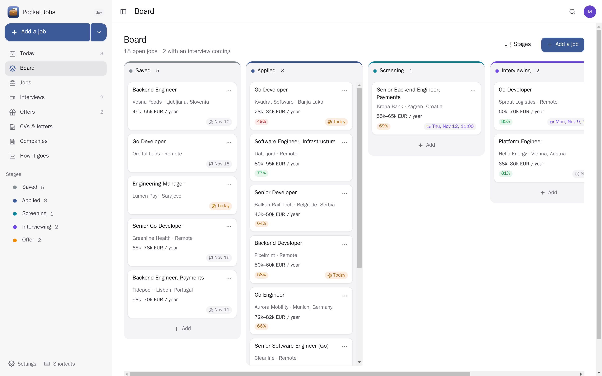
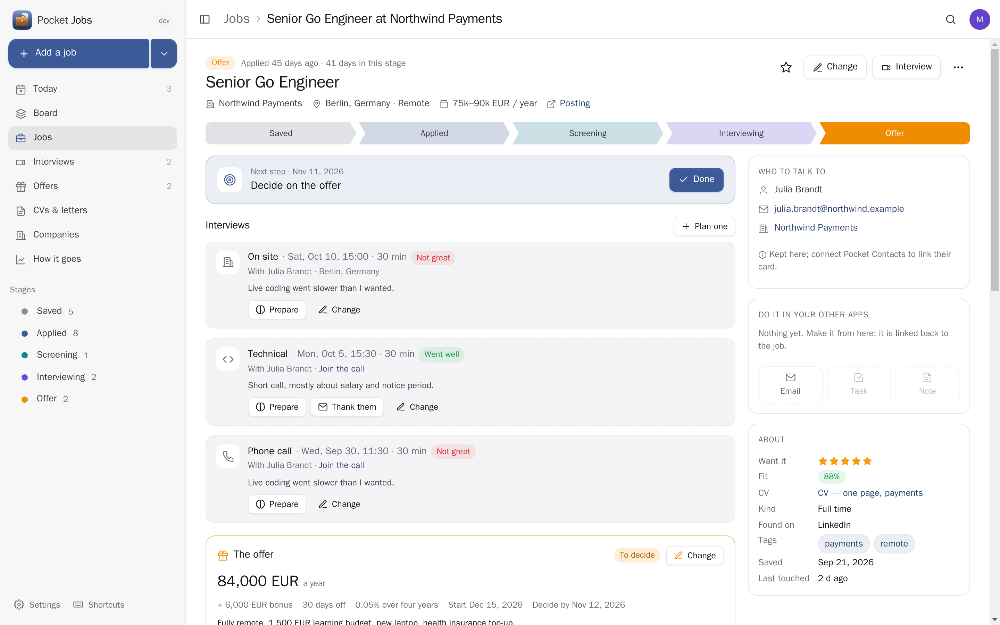
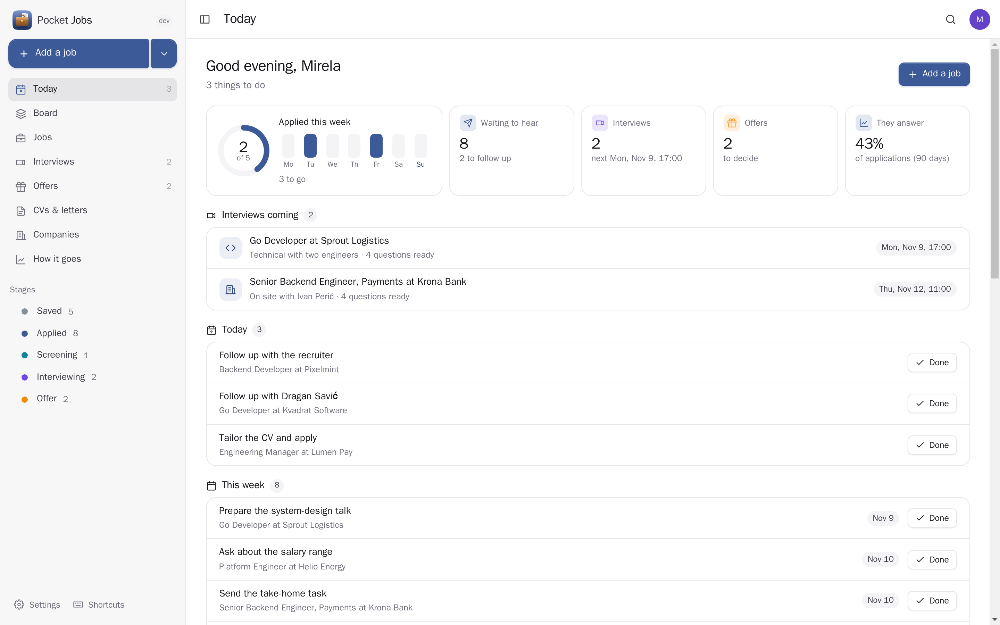
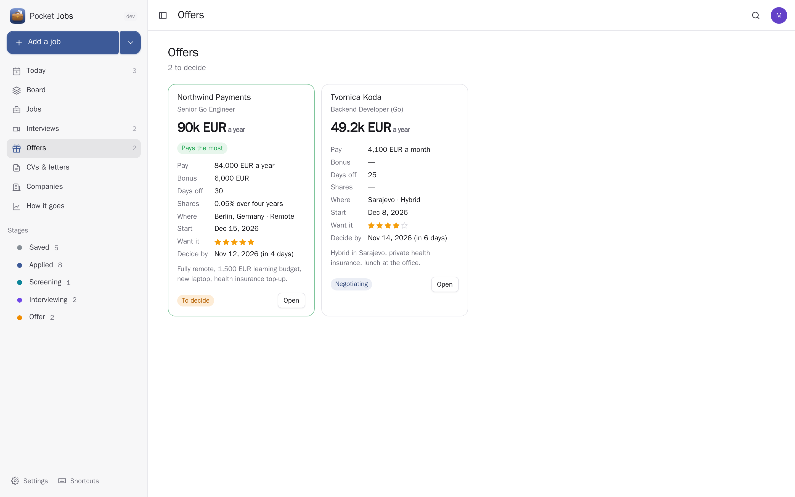
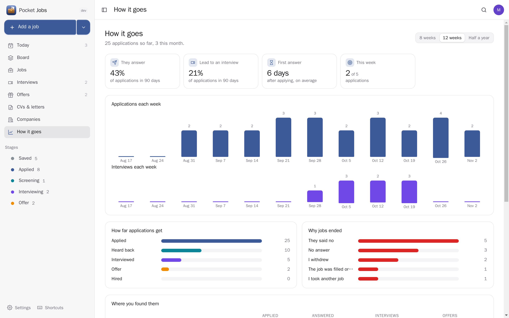
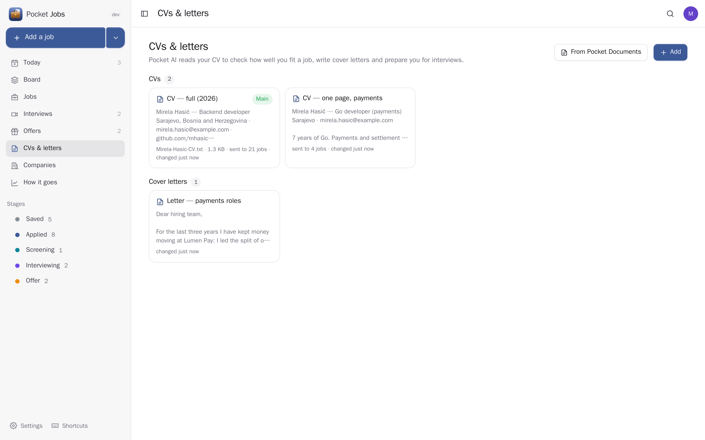
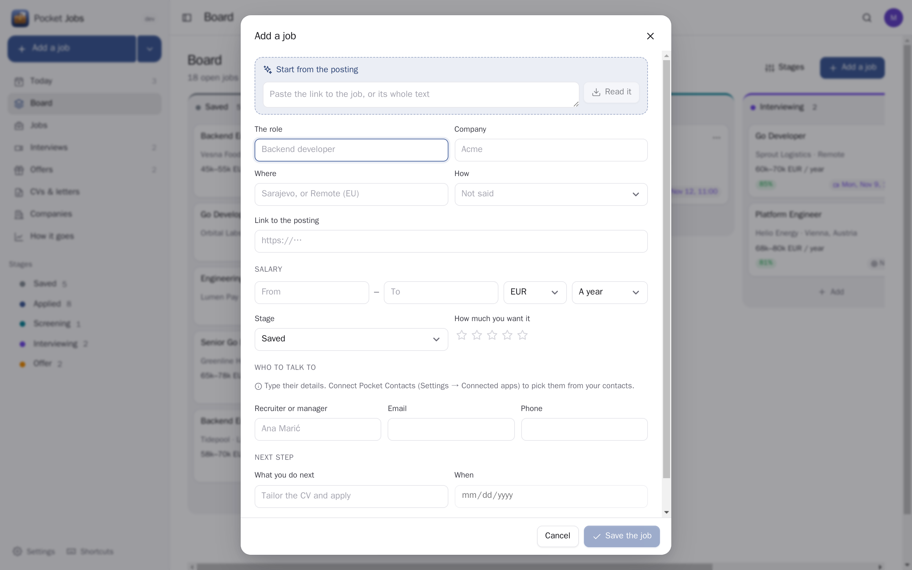
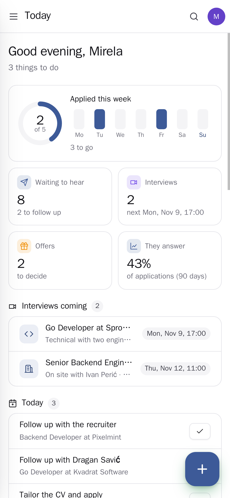
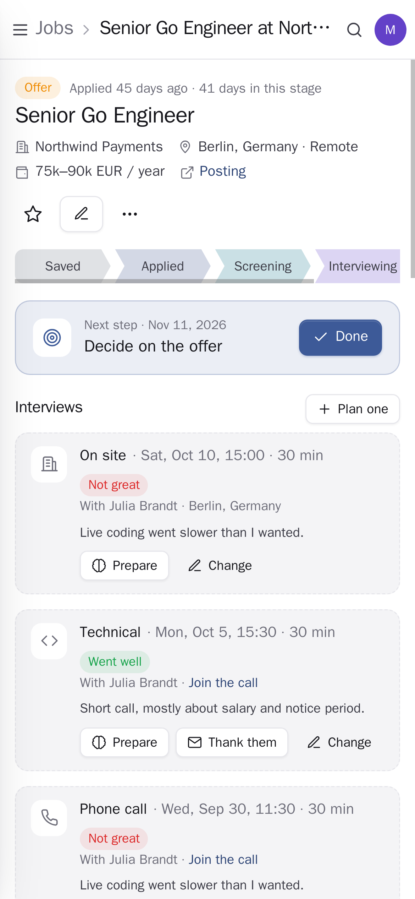
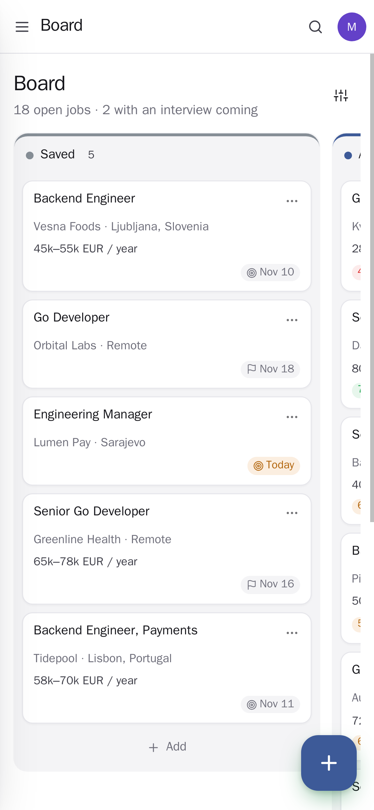

<p align="center"></p>
<h1 align="center">Pocket Jobs</h1>
<p align="center">Your job search in one place: the jobs you want on a board from saved to hired, with the posting, the salary, who to talk to, the next step and everything that happened. Paste a link and it reads the posting. Plan interviews (they go to your calendar) and prepare the questions; weigh offers side by side; keep your CVs and cover letters; see week by week how the search goes. Pocket AI checks how well your CV fits a job, writes the cover letter and drafts the follow-ups. Bring your jobs from Huntr, Teal or a spreadsheet.<br>One Go binary, one SQLite file, one volume. Part of the Pocket apps; works on its own too.</p>
<p align="center">
  <a href="https://github.com/abjelosevic88/pocket-homelab-jobs/actions"></a>
  <a href="https://github.com/abjelosevic88/pocket-homelab-jobs/pkgs/container/pocket-homelab-jobs"></a>
  <a href="LICENSE"></a>
</p>

---

<p align="center"></p>

<table>
  <tr>
    <td width="50%"></td>
    <td width="50%"></td>
  </tr>
  <tr>
    <td align="center"><sub>A job: the stage, the next step, the interviews, the offer, Pocket AI's help, the posting and the timeline.</sub></td>
    <td align="center"><sub>Today: the week's goal, interviews coming, steps due, applications to follow up, offers to decide.</sub></td>
  </tr>
  <tr>
    <td width="50%"></td>
    <td width="50%"></td>
  </tr>
  <tr>
    <td align="center"><sub>Offers side by side, the pay counted for a year — and Pocket AI's view on deciding and negotiating.</sub></td>
    <td align="center"><sub>How it goes: applications and interviews each week, how far they get, which sources answer, why jobs end.</sub></td>
  </tr>
  <tr>
    <td width="50%"></td>
    <td width="50%"></td>
  </tr>
  <tr>
    <td align="center"><sub>CVs and cover letters: the text Pocket AI reads and the file you send; from Pocket Documents too.</sub></td>
    <td align="center"><sub>Adding a job: paste the link (the page's job data fills the form) or the posting's text.</sub></td>
  </tr>
</table>

<p align="center">
  
  
  
</p>

## What it does

- **A board from saved to hired.** Stages you name and colour, each meaning saved, applied, talking, offer, hired or closed. Moving a job to an "applied" stage marks it applied today; to a "talking" one counts as an answer. Drag cards on a computer, use the card's menu on a phone.
- **Read a posting.** Paste a link: most job sites put the job in the page as structured data (role, company, place, pay, apply-by), and that fills the form without any AI. Paste the text and Pocket AI reads it. A link shared to `/jobs/new?url=…` opens the form filled in.
- **Interviews.** Phone, video, on site, technical, take-home, panel, final — with the time, the place or call link, who you meet, your preparation and the questions to practise. They go to Pocket Calendar (and move with it), warn when they clash with something, show the weather for an in-person one, and an hour before, a push reminds you. Afterwards: how it went, your notes, a thank-you email.
- **Offers side by side.** Pay per year, month or hour counted up for a year, bonus, days off, shares, start and decide-by days. Accepting one moves the job to Hired; declining closes it.
- **CVs and cover letters.** The text (what Pocket AI reads) and the file you send. One CV is your main one; a job can use another.
- **Today and how it goes.** A weekly goal, applications that need a follow-up, jobs that close soon; the answer rate, the interview rate, days to a first answer, and which sources and kinds of job answer.
- **Pocket AI** (Pocket AI through Core, or your own OpenAI key): how well your CV fits a job (a score, what matches, what is missing), a cover letter for it, how to change your CV for it, what to find out about the company, interview questions with answer notes from your CV, follow-up / thank-you / accept / decline emails, the next step, and help weighing offers. Only when you press the button; nothing is saved or sent until you say so.
- **Bring your search.** CSV from Huntr, Teal, Simplify or a spreadsheet, or a Pocket Jobs export — the same file twice adds nothing twice. Export everything as JSON or every job as CSV.

## With the other Pocket apps

Through [Pocket Core](https://github.com/abjelosevic88/pocket-homelab-core) app links (each person switches them on; nothing to paste), or directly with a URL and an API token. Each one greys out on its own when it is not there — the job keeps everything itself.

| App | What Jobs does with it |
|---|---|
| Pocket Contacts | Pick the recruiter or the hiring manager; add them and their company there |
| Pocket Mail | Your emails with the company on the job's page; send follow-ups and thank-yous from your own mailbox |
| Pocket Calendar | Interviews in your calendar, moved with them; clashes with other events |
| Pocket Tasks | Next steps as tasks; ticking one off there ticks it here |
| Pocket Notes | Save a job or your interview preparation as a note |
| Pocket Documents | Bring a CV you keep there, with the text Documents read from it |
| Pocket Learn | Interview questions become flashcards to practise |
| Pocket Weather | The weather at the place and hour of an in-person interview |

Jobs offers `jobs:read` and `jobs:write` to the rest of the box: Pocket AI answers "how is my job search going?" and saves a job or an interview when you ask (`pocket_jobs_*` tools in Core), and the events `jobs.job_added`, `jobs.applied`, `jobs.stage_changed`, `jobs.interview_planned`, `jobs.offer_received`, `jobs.hired`, `jobs.closed` and `jobs.steps_due` go out for Pocket Flows.

## Run it

```sh
docker run -d --name pocket-jobs -p 8080:8080 -v pocket-jobs:/data \
  -e BASE_URL=https://jobs.example.com -e ADMIN_EMAIL=you@example.com -e ADMIN_PASSWORD=change-me-please \
  ghcr.io/abjelosevic88/pocket-homelab-jobs:latest
```

Or `docker compose up -d` with the [docker-compose.yml](docker-compose.yml), or a release binary (Linux, macOS, Windows, FreeBSD). Try it with demo data: `make run` (a ten-week search, no sign-in). Every person on a box has their own search; admins do not see anyone else's.

- [Configuration](docs/configuration.md) — every environment variable
- [API](docs/api.md) — the JSON API and tokens
- [Backups](docs/backup.md), [reverse proxy](docs/reverse-proxy.md)

## Develop

Go 1.26 and Node 22. `make dev` runs the API with demo data and Vite; `make test` runs `go vet`, the Go tests and the TypeScript check; `make docker` builds the image.

MIT © 2026 Aleksandar Bjelosevic
